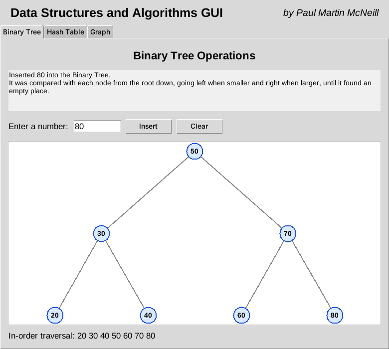
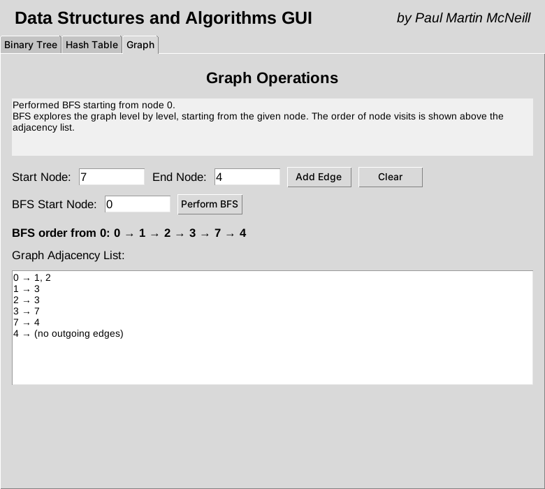

# Data Structures & Algorithms in Python

[](https://github.com/mcneillium/DataStructuresAlgorithms/actions/workflows/tests.yml)

Three core data structures written from scratch in plain Python, with a
Tkinter GUI for trying them out and pytest tests for each.

Case study: [paulmartinmcneill.com/projects/data-structures-python](https://paulmartinmcneill.com/projects/data-structures-python/)

| Binary search tree | Graph and breadth-first search |
| --- | --- |
|  |  |

## What's inside

| Folder | Structure | Operations |
| --- | --- | --- |
| `trees/` | Binary search tree | insert, in-order traversal (returns keys sorted), `layout()` for drawing |
| `graphs/` | Directed graph (adjacency list) | add edge, list nodes, breadth-first search |
| `hash_tables/` | Hash table with separate chaining | set, get, delete, `in`; colliding keys are kept |
| `main_gui.py` | Tkinter GUI | one tab per structure, with input checks and explanations |
| `tests/` | pytest | 9 tests covering each structure |

## Run it

You need [uv](https://docs.astral.sh/uv/), which fetches the right Python (3.13
or later, with Tkinter included) and the development tools for you.

```bash
git clone https://github.com/mcneillium/DataStructuresAlgorithms.git
cd DataStructuresAlgorithms
uv run main_gui.py        # opens the GUI
uv run pytest             # runs the tests
uv run mypy               # checks the types
```

The code itself uses only the standard library, so `python main_gui.py` also
works on any Python 3.13 or later that has Tkinter.

## Changes since the first version (November 2026)

- **Breadth-first search** no longer crashes when an edge points to a
  higher-numbered vertex than any source vertex (it used a list sized by the
  largest source). It now uses a set and a deque, and works with any vertex
  type.
- **Hash table** now keeps keys whose hashes collide (for example `"ab"` and
  `"ba"`); before, the second silently overwrote the first. Missing keys raise
  `KeyError`.
- Added tests, continuous integration, and a `.gitignore`; removed committed
  `__pycache__` files.

### Second round (November 2026)

- The **tree tab draws the tree**, each node at its in-order position and
  depth, so you can see where a value lands. Before, it only printed the
  sorted list, which hid the shape (and so the point) of the tree.
- The **graph tab** showed the BFS visit order in the box labelled
  "Adjacency List", overwriting the list. Both are now shown, and the BFS
  controls sit on their own row (they were cut off at the window edge).
- BFS can **start from a node that only appears as an edge's target**; the
  GUI used to refuse it even though the algorithm handles it.
- The hash table view groups keys by slot, so a collision is visible.

### Third round (November 2026): current tooling

- The three structures are **fully typed** with Python's newer generic syntax
  (`class HashTable[K, V]`, `class BinaryTree[T: Comparable]`), and mypy checks
  them in strict mode.
- **uv** manages Python and the development tools from one `pyproject.toml`
  and a lock file. **Ruff** lints and formats the code.
- The tests, type check and lint run on **Python 3.13, 3.14 and 3.15** on
  every push. Dependabot proposes updates once a month.

## Licence

MIT, see [LICENSE](LICENSE).
